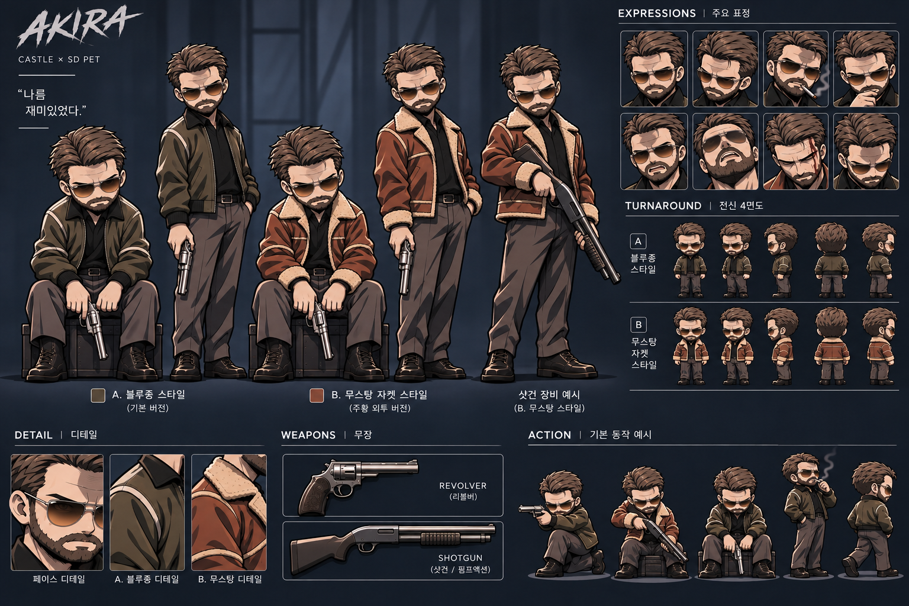

# Akila B — 공식 캐릭터 기준 시트 (2026-11-06 사용자 재확정)

> **최상위 시각 기준: [akila-sheet-02.png](../design/references/akila-sheet-02.png)**  
> 사용자가 채팅에 다시 제시한 AKIRA/CASTLE × SD PET 전체 디자인 시트와 동일한 구성의 이미지가 저장소에 이미 등록되어 있음을 확인했다. 기존 등록 파일을 보존하고, 이 파일의 **B형 갈색 무스탕 디자인을 공식 캐릭터 기준**으로 재지정한다. 예전 '두 시트 퇴역' 선언은 폐기한다.

## 참조 우선순위

1. **주 기준 — 큰 전신 그림:** 상단 중앙의 **B형 무스탕 서 있는 전신**과 그 왼쪽의 **B형 앉은 전신**. **머리 : 몸통 : 다리 : 부츠의 실제 비율**, 얼굴·양털·의상·선 굵기·명암·전체 실루엣을 그대로 따른다.
2. **보조 — 시트 우측 TURNAROUND B:** 무스탕의 전·측·후면 의상 요소와 머리 방향 이해에 쓴다. 작은 턴어라운드 그림 특유의 더 짧은 비율을 큰 전신에 강제하지 않는다.
3. **보조 — 우측 표정과 하단 DETAIL/ACTION/WEAPONS:** 표정·선글라스·수염·리볼버·샷건과 동작 방향 참고. 총기·표정 연출은 공식 B형 외형을 바꾸지 않는다.
4. **하위 후보:** `src/characters/candidates/akila_mustang/idle-gate1b-alpha-cleanup-unapproved.png` 및 이전 작업 후보는 **기술적/아트 실험 이력이며 신체 비율과 캐릭터 외형의 기준이 아님.** 시트와 다르면 후보를 고친다. 시트를 후보에 맞추지 않는다.
5. `design/references/akila-sheet-01.png`은 참고용, A형 블루종은 기존 기능 보존/향후 선택 의상. B형 디자인의 우선순위를 덮을 수 없다.

## 2026-11-06 추가 캐릭터 설정 — 사용자 확정

- **기본 얼굴에 이마 흉터 없음.** Sitting·Smoking·Idle을 비롯한 일상 포즈는 흉터를 그리지 않는다. 감정 표현용 미간 주름과 흉터를 구분할 것.
- **평상시 권총 홀스터 없음.** Idle·Smoking·Sitting에 허리 또는 허벅지 홀스터를 임의 추가하지 않는다. Drawing/Firing은 필요 시 별도 총기 등장 포즈로 처리한다.
- **서 있는 기본 Idle의 이마 그림자 완화.** 진한 패치 형태의 음영은 피하되 얼굴 형태·표정·기존 머리카락 형태를 보존한다.
- 이너·하의 구분: **B형 무스탕=검은 무지 티셔츠+중립 회색 바지**, **A형 블루종=검은 칼라 셔츠+청회색 바지**.
- 위 사항을 신규 생성하는 모든 포즈와 QA 체크리스트에 적용한다. 현재 제작한 PNG 후보가 이를 만족했다고 자동 승인하지 않는다.

## 반드시 유지

- 서 있는 B형의 **원본 신체 비율**. 특히 머리를 과장해 키우거나 다리를 줄여 '더 SD스럽게' 재해석하지 말 것.
- 어두운 갈색 올백 헤어, 짙은 수염, 브라운 틴트 에비에이터 선글라스, 과묵한 인상.
- 갈색 무스탕 + 밝은 양털 칼라/소매, 검은 셔츠, 회색 바지, 검은 부츠.
- Idle용 정제 스프라이트는 상단 B형 전신을 기준으로 하되 **리볼버를 들지 않은 중립 자세**로 만든다. 시트의 오른손 리볼버는 Drawing/Firing 자료로 유지한다. **캐릭터 오른손 = 정면에서 화면 왼쪽**.
- Sitting, Smoking, Speaking, Working, Drawing, Firing, Dual Firing 전 상태에서 같은 비율과 스타일 유지. 시트의 리볼버와 샷건은 **별개 무기**이며 샷건 모션은 이후 확장.
- 1024×1600은 **선호하는 투명 정렬 캔버스**일 뿐 인물 비율 강제 규격이 아니다. 필요하면 투명 여백을 두고 균일 확대·축소만 허용한다.
- 배경 분리 시 원본 인물 픽셀과 비율 보존 우선. 추출/마스킹 상태와 **최종 알파 품질·사용자 시각 승인**을 구분한다.

## 현 상태와 변경 금지

- 이 문서로 **기준 시트는 확정**되지만, 서 있는 Idle의 투명 PNG/애니메이션 아트 최종 승인은 아직 아니다.
- 저장소에 이미 있던 `akila-sheet-02.png`를 중복 파일로 추가하지 않고 원본 등록 파일을 공식 참조로 지정한다. 추가 사용자 업로드는 동일 구성의 시트를 재확인한 근거다.
- A형 런타임/기존 기능/기존 PNG 보존; B형은 승인·전체 상태 제작 전 런타임 미활성.
- PR #6 Draft 유지. main 병합·배포 금지.

## 다음 작업

1. 시트에서 상단 중앙의 **B형 무스탕 전신**을 비율 그대로 크롭·검수한다(현재 주변 배경과 다른 캐릭터가 포함된 크롭은 완성 투명 PNG로 취급하지 않는다).
2. 손·리볼버 분리와 투명 경계 정리 후, 원본과 **나란히 비교**한다. 원본과 다르게 새로 그린 비율 후보는 탈락.
3. 사용자 시각 승인 뒤 **B형 Idle 마스터**로 지정하고 나머지 포즈 제작.
